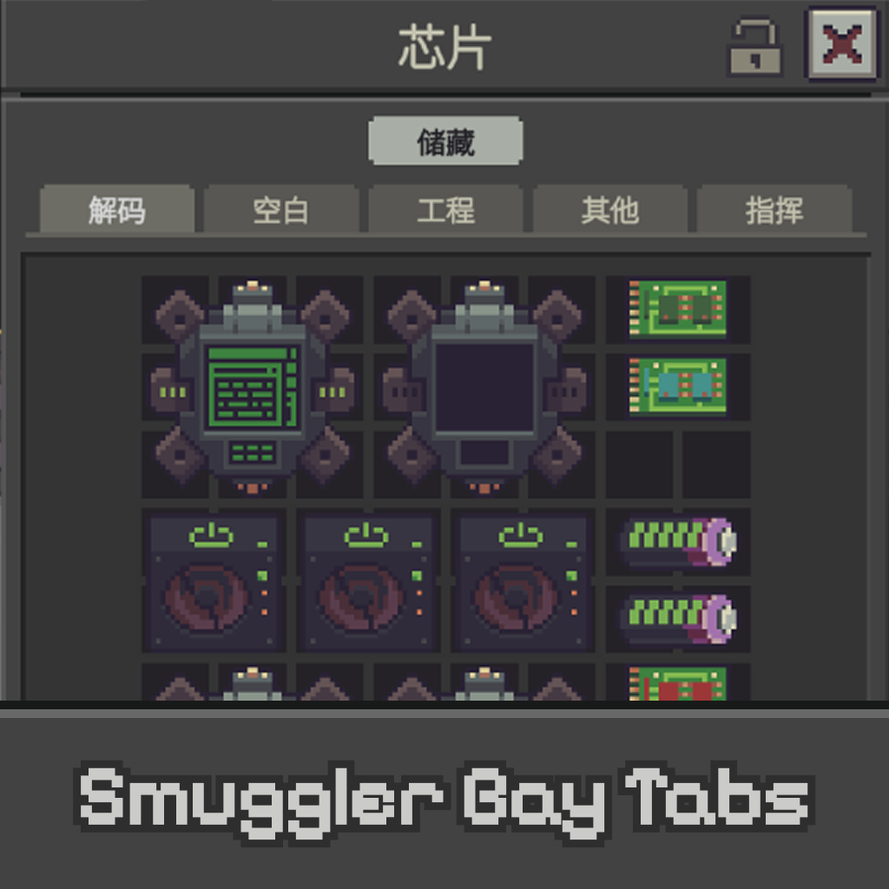
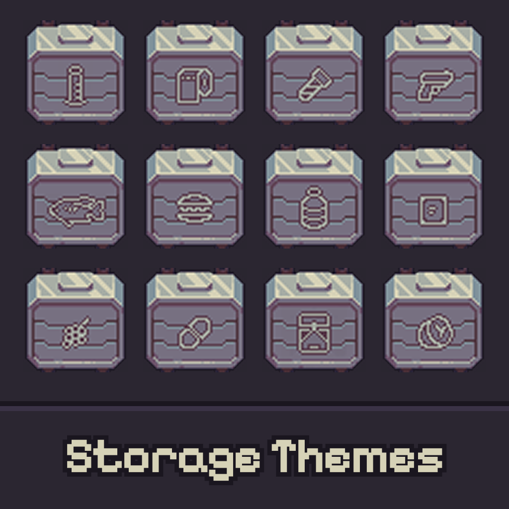

# Probably Stolen Mods / 深空当铺模组

[Mods made by CanisMinor](https://steamcommunity.com/id/canisminor/myworkshopfiles/?appid=4348910)

## Mods

<!-- mods-table -->
| Cover | Folder | Title | Description | Steam |
|-------|--------|-------|-------------|-------|
|  | [SmugglerBayTabs](src/SmugglerBayTabs) | Smuggler Bay Tabs / 暗格储物标签 | The smuggler bay and the improved smuggler bay accept the storage expansion kit. The bay gains 2 tabs per kit, the improved bay gains 1, and both stop at 5 tabs, matching the storage bay and the expanded storage bay. |  |
|  | [StorageThemes](src/StorageThemes) | Storage Themes / 储物舱涂装 | Adds painted theme sprites to storage bays, smuggler bays, the hypertech bay, and machine bays. The appearance toggle opens a theme panel. | [Workshop](https://steamcommunity.com/sharedfiles/filedetails/?id=3830120722) |
<!-- /mods-table -->

## Commands

```text
npm run build
npm run build:storage-themes
npm run build:smuggler-bay-tabs
npm run desc
npm run index
npm run workshop-desc
npm run steam-ids
npm run package
npm run clean
```

| Script | What |
|--------|------|
| `build` | Compile every mod and install it into the game `Mods` folder |
| `build:storage-themes` | Compile and install Storage Themes only |
| `build:smuggler-bay-tabs` | Compile and install Smuggler Bay Tabs only |
| `desc` | Generate Workshop `Description.txt` from each mod README, and refresh the mods table |
| `index` | Rebuild the root README mods table from `src/*/README.md` and `package.json` |
| `workshop-desc` | Push each published mod's English and Chinese description to Steam. Steam must be open. This does not upload the mod files |
| `steam-ids` | Read the author's Workshop page and fill `mods.steamId` plus the mods table |
| `package` | `build` + `desc` |
| `clean` | Remove build output |

The repo is expected to sit inside the game folder. A checkout anywhere else needs `/p:GameDir=` or a `GameDir` environment variable pointing at the folder that contains `Probably Stolen.exe`.

`preview.png` stays next to the mod project file and is installed beside `manifest.xml`. `psd` and `Reference` stay in the repo and are not installed.

Edit `src/<Mod>/README.md` for the Workshop text. Do not hand-edit `Description.txt` or the mods table between the `mods-table` markers. `npm run desc` refreshes both.

Fully quit the game after a DLL or PNG change.
