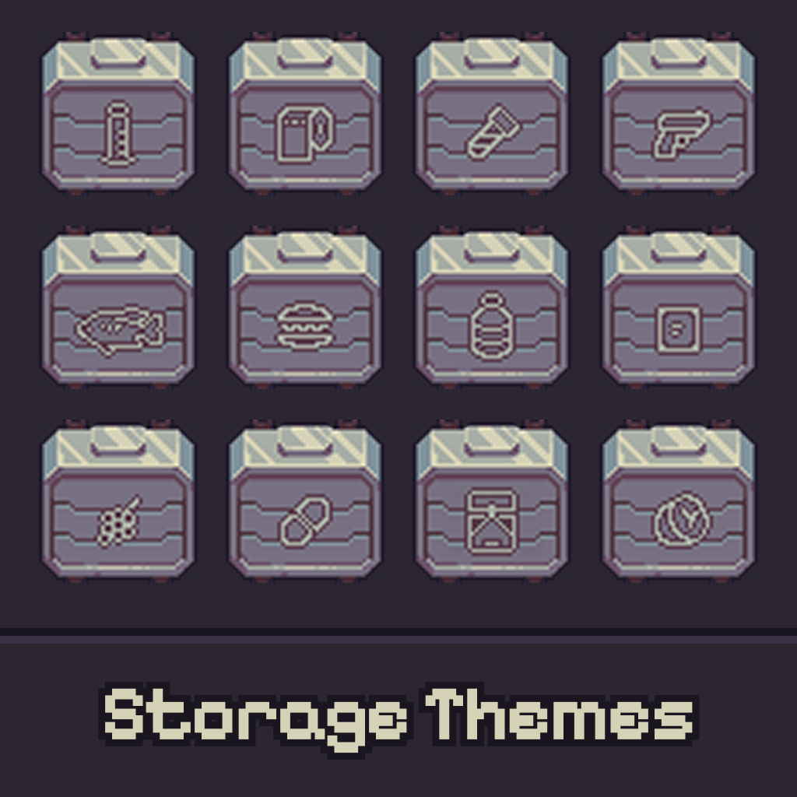

# Probably Stolen Mods / 深空当铺模组

[Mods made by CanisMinor](https://steamcommunity.com/sharedfiles/filedetails/?id=3830120722)

## Mods

| Cover | Folder | Title | Description | Steam |
|-------|--------|-------|-------------|-------|
|  | [StorageThemes](src/StorageThemes) | 储物舱涂装 / Storage Themes | 给储物舱、走私舱、超科技舱和机械舱加上绘制的主题贴图。切换外观时打开涂装面板。 Adds painted theme sprites to storage bays, smuggler bays, the hypertech bay, and machine bays. The appearance toggle opens a theme panel. | [Workshop](https://steamcommunity.com/sharedfiles/filedetails/?id=3830120722) |

## Commands

```text
npm run build
npm run build:storage-themes
npm run clean
```

| Script | What |
|--------|------|
| `build` | Compile every mod and install it into the game `Mods` folder |
| `build:storage-themes` | Compile and install Storage Themes only |
| `clean` | Remove build output |

The repo is expected to sit inside the game folder. A checkout anywhere else needs `/p:GameDir=` or a `GameDir` environment variable pointing at the folder that contains `Probably Stolen.exe`.

`preview.png` stays next to the mod project file and is installed beside `manifest.xml`. `psd` and `Reference` stay in the repo and are not installed.

Fully quit the game after a DLL or PNG change.
