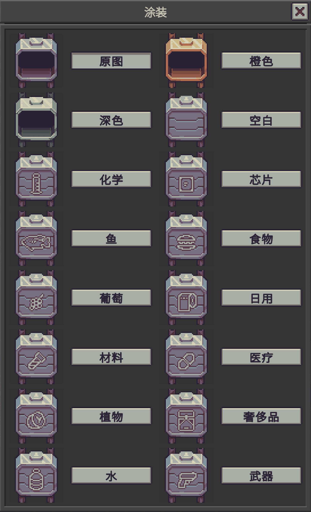
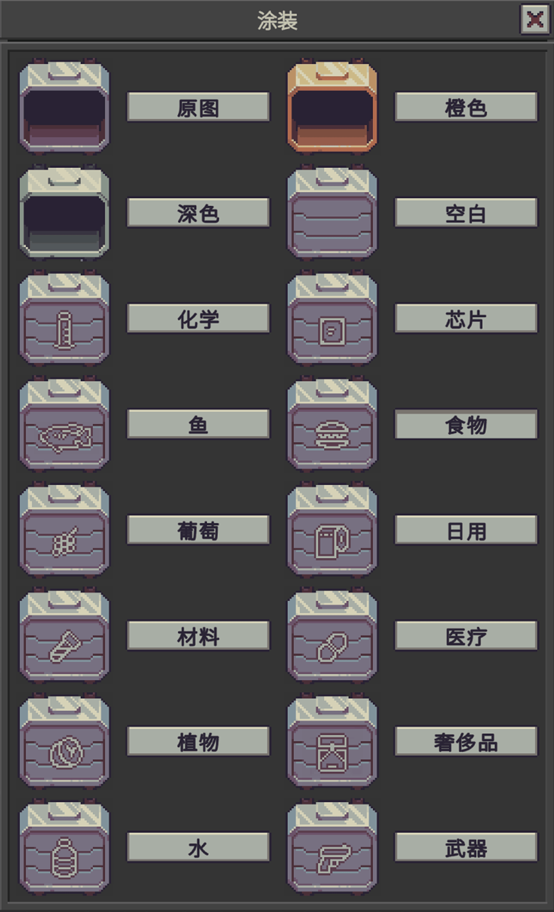
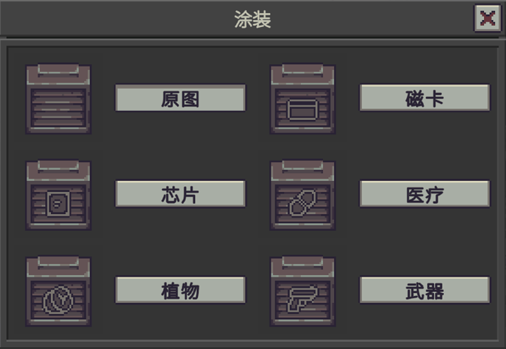
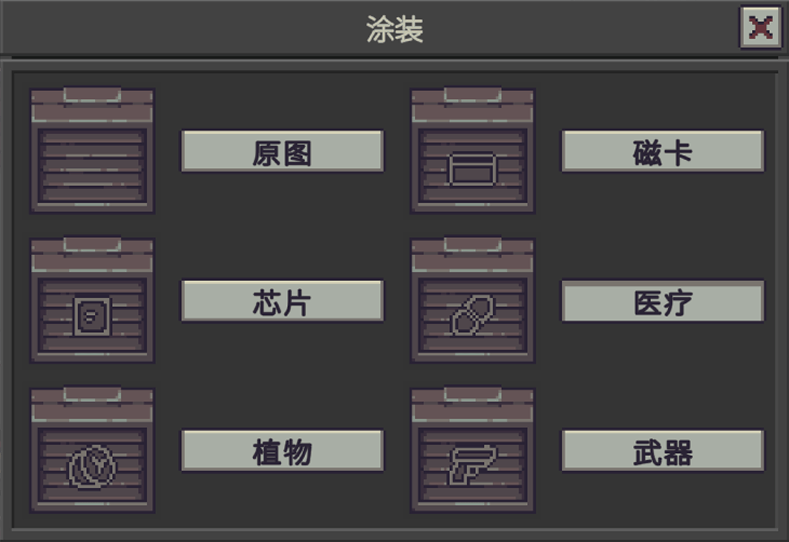
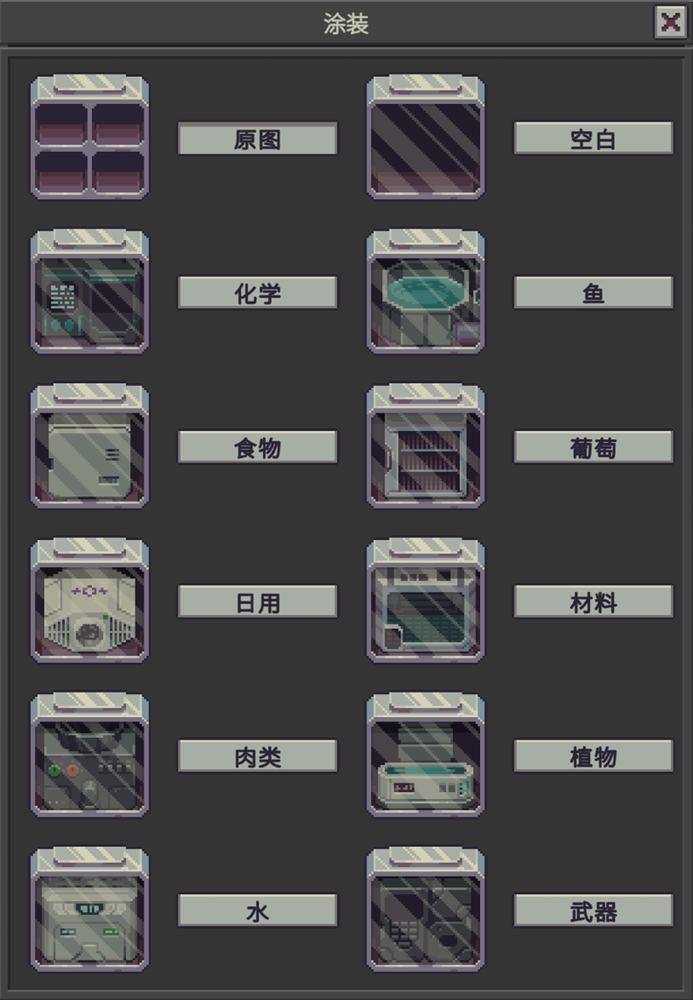
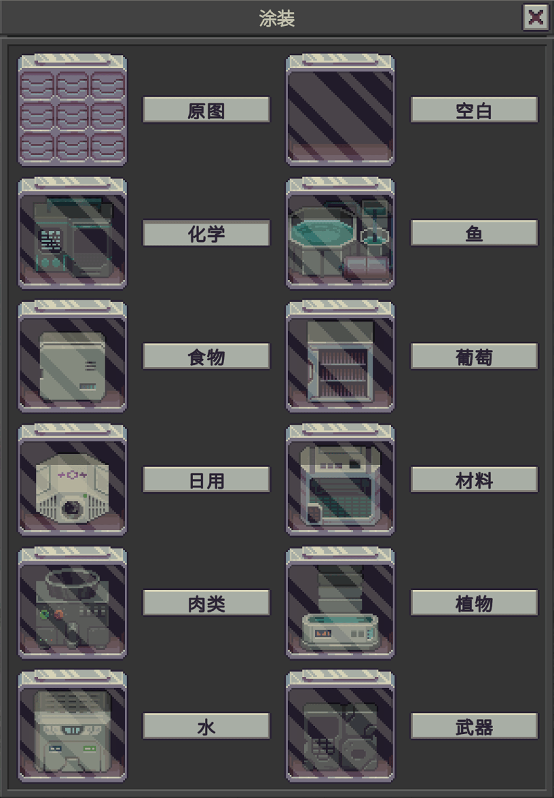

# Storage Themes

Adds painted theme sprites to storage bays, smuggler bays, the hypertech bay, and machine bays. The appearance toggle opens a theme panel.

This is only a cosmetic mod. Storage capacity and contents are unchanged.

Storage bay

Large storage bay

Smuggler bay

Large smuggler bay

Machine bay

Extended machine bay

Steam Workshop: [储物舱涂装 / Storage Themes](https://steamcommunity.com/sharedfiles/filedetails/?id=3830120722) · [Description.txt](Description.txt) (BBCode)

### Languages

UI text covers English and Chinese.

### Features

- Works on the storage bay, the large storage bay, the smuggler bay, the large smuggler bay, the hypertech bay, the machine bay, and the extended machine bay.
- Toggle appearance to open the theme panel, then pick a skin.
- Storage bays keep the vanilla frames: Original, Orange, and Dark.
- The machine bay keeps its five fill sprites, `machine_bay0` through `machine_bay4`. One `machine_bay.png` covers all five, and the skin stays on as the bay fills. A `machine_bay0.png` through `machine_bay4.png` file is used for that fill level when it exists.
- A painted theme appears when its sprite is in that theme folder. Storage bays and the hypertech bay have the full set. Machine bays have Blank, Chemistry, Fish, Food, Grape, Household, Material, Meat, Plant, Water, and Weapon. Smuggler bays currently have Card, Chip, Medical, Plant, and Weapon.

### Settings

- Open the Mods list, then click Settings on this mod.
- Each container kind has its own switch: storage bays, smuggler bays, the hypertech bay, and machine bays. The game asks for a restart. A kind that is off shows its original art.

### Feedback & Source

- Repository: [canisminor1990/probably-stolen-mods](https://github.com/canisminor1990/probably-stolen-mods)
- Bugs and requests go on [GitHub Issues](https://github.com/canisminor1990/probably-stolen-mods/issues).
- If you like the work and want to support it: [ko-fi.com/canisminor1990](https://ko-fi.com/canisminor1990)

---

# 储物舱涂装 / Storage Themes

*给储物舱、走私舱、超科技舱和机械舱加上绘制的主题贴图。切换外观时打开涂装面板。*

仅装饰，不改变容量和里面的东西。

储物舱

大号储物舱

走私舱

大号走私舱

机械舱

扩展机械舱

### 语言

界面文本覆盖英语和中文。

### 功能

- 支持储物舱、大号储物舱、走私舱、大号走私舱、超科技舱、机械舱和扩展机械舱。
- 切换外观打开涂装面板，再点选一种涂装。
- 储物舱保留游戏自带的三档：原图、橙色、深色。
- 机械舱仍按装填程度使用 `machine_bay0` 到 `machine_bay4`。一张 `machine_bay.png` 覆盖这五档，装东西时涂装不会掉。如果另外放了 `machine_bay0.png` 到 `machine_bay4.png`，那一档就用对应的图。
- 某个主题文件夹里有对应图片，面板里才会出现它。储物舱和超科技舱是全套。机械舱目前有空白、化学、鱼、食物、葡萄、日用、材料、肉类、植物、水、武器。走私舱目前有磁卡、芯片、医疗、植物、武器。

### 设置

- 打开模组列表，点击本模组的「设置」。
- 可以按容器种类分别开关：储物舱、走私舱、超科技舱、机械舱。游戏会要求重启。关掉的那一类显示原图。

### 问题反馈与源码

- 模组仓库：[canisminor1990/probably-stolen-mods](https://github.com/canisminor1990/probably-stolen-mods)
- 问题请开 [GitHub Issues](https://github.com/canisminor1990/probably-stolen-mods/issues)。
- 喜欢这些模组、想支持一下：[ko-fi.com/canisminor1990](https://ko-fi.com/canisminor1990)
